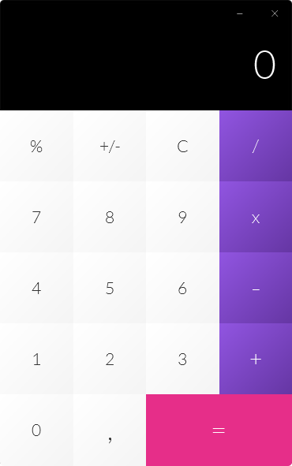

# Phoenix Calculator

[](https://github.com/mperor/PhoenixCalculator/actions/workflows/build.yml)
[](https://github.com/mperor/PhoenixCalculator/releases/latest)

A desktop calculator built with **JavaFX 25** and **Java 25**: a frameless, draggable window styled with CSS,
a pure calculator engine built on records, sealed types and pattern matching, and native installers for Windows, macOS and Linux.

<p align="center">
  
</p>

## Download

Get the latest package from [Releases](https://github.com/mperor/PhoenixCalculator/releases/latest).
Every package bundles its own Java runtime, so you don't need Java installed.

| OS | Package | How to run |
|---|---|---|
| Windows (x64) | `.msi` installer or portable `.zip` | Run the installer, or unzip and start `PhoenixCalculator.exe` |
| macOS (Apple Silicon) | `.dmg` | Open the image and drag the app to Applications |
| Linux (x64) | `.deb` or portable `.tar.gz` | `sudo apt install ./PhoenixCalculator-*.deb`, or extract and run `PhoenixCalculator/bin/PhoenixCalculator` |

The packages are not code-signed. On first launch:
- **Windows** SmartScreen shows a warning. Choose *More info → Run anyway*.
- **macOS** Gatekeeper may block the app. Right-click it and choose *Open*, or allow it in *System Settings → Privacy & Security*.

## Features

- **Arithmetic:** addition, subtraction, multiplication, division, percent and sign change, with a decimal comma.
- **Expression line:** shows the calculation above the result, e.g. `1000 + 24 =`.
- **Repeat:** pressing `=` again repeats the last operation (`1 + 2 = =` gives `5`).
- **Precision:** results keep 16 significant digits. Very large and very small numbers switch to scientific notation.
- **Errors:** division by zero shows `undefined` until you enter a new number or clear.
- **Keyboard:** full keyboard support, with the pressed button animating as if clicked.
- **Window:** frameless and transparent with its own minimize and close buttons; drag it anywhere to move it.
- **Startup:** shows a splash screen through a JavaFX `Preloader`.

### Keyboard shortcuts

| Key | Action |
|---|---|
| `0`–`9`, numpad digits | Digit |
| `,`, numpad decimal point | Decimal comma |
| `+` (`Shift+=`, numpad `+`) | Add |
| `-`, numpad `-` | Subtract |
| `*` (`Shift+8`, numpad `*`) | Multiply |
| `/`, numpad `/` | Divide |
| `%` (`Shift+5`) | Percent |
| `Enter`, `=` | Result |
| `Backspace` | Delete the last character of the number being typed |
| `Esc`, `Delete` | Clear |

`Shift` combinations assume a US keyboard layout. Sign change (`+/-`) is button-only.

## Build from source

You need JDK 25 or newer (`JAVA_HOME` must point to it). The Maven Wrapper downloads Maven itself.

```bash
./mvnw javafx:run        # run the app
./mvnw verify            # build and run the tests
```

To build native packages for your OS into `target/release`:

```bash
packaging/package.sh 1.0.0
```

On Windows, run the script from Git Bash. Building an `.msi` also needs [WiX 5](https://wixtoolset.org/) with its UI and Util extensions:

```bash
dotnet tool install --global wix --version 5.0.2
wix extension add -g WixToolset.Util.wixext/5.0.2 WixToolset.UI.wixext/5.0.2
```

### Releasing

Push a version tag, for example `git tag v1.0.0 && git push origin v1.0.0`.
The [Release workflow](.github/workflows/release.yml) then tests and packages the app on Windows, macOS and Linux and publishes a GitHub Release with all packages attached.

## Architecture

```
eu.mapidev.calculator.phoenix
├── ApplicationLauncher, ApplicationLoader   JavaFX Application + Preloader (splash screen)
├── MainController                           FXML controller: window controls, buttons, keyboard
├── CalculatorViewModel                      observable state for the view
├── CalculatorKeyBindings                    key event -> calculator input
└── engine                                   pure calculator logic, no JavaFX dependency
    ├── CalculatorInput    sealed interface: CalculatorDigit | ArithmeticOperation | Command
    ├── CalculatorState    immutable record: display, memory line, operands, last input
    ├── CalculatorEngine   apply(state, input) -> new state
    └── DisplayFormat      BigDecimal <-> display text
```

- **Engine.** The engine is a pure function, `CalculatorEngine.apply(CalculatorState, CalculatorInput)`.
  - An exhaustive pattern-matching `switch` over the sealed `CalculatorInput` handles every input.
  - Each step returns a new immutable `CalculatorState`, which makes the logic easy to test.
- **View model.** `CalculatorViewModel` keeps the state in a JavaFX property and exposes the result and memory line with `ObservableValue.map`. `MainController` binds the labels to them.
  - The view model uses only `javafx.base`, so its tests need no UI toolkit.
- **Buttons.** Each button in `main-view.fxml` carries its input token in `userData`, for example `userData="+/-"`. Button labels are free text and don't drive the logic.
- **Tests.** The behaviour is specified by [`CalculatorScenarioTest`](src/test/java/eu/mapidev/calculator/phoenix/engine/CalculatorScenarioTest.java), a table of key sequences with the expected result and memory line:

  ```
  # keys                  | result    | memory
  2 0 0 + 1 0 = 5 x 2 =   | 10        | 5 x 2 =
  1 / 0 =                 | undefined | ''
  ```

## Tech stack

| Area | Tools |
|---|---|
| Language | Java 25 (records, sealed interfaces, pattern-matching `switch`) |
| UI | JavaFX 25 (FXML, CSS, properties and bindings, `Preloader`) |
| Build and tests | Maven Wrapper, JUnit 6 with parameterized tests |
| Packaging and CI | jlink and jpackage, GitHub Actions (CI plus release builds on three OSes) |

## Author

[mperor](https://github.com/mperor)
